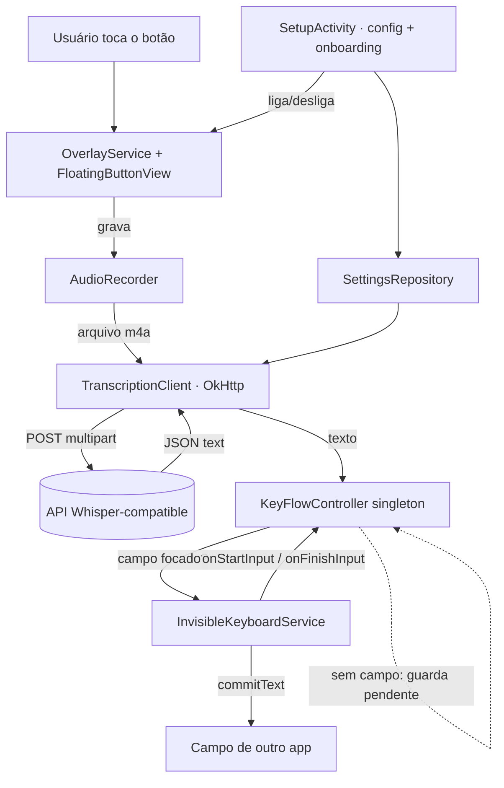

# Voice Keyboard — Design

**Spec**: `.specs/features/voice-keyboard/spec.md`
**Status**: Draft

---

## Architecture Overview

App Android nativo (Kotlin) com **um único processo** e três superfícies que conversam por um singleton em memória (`KeyFlowController`). O IME e o overlay nunca compartilham memória entre processos porque, por design, vivem no mesmo processo do app.



**Fluxo feliz**: campo focado → IME registra-se no controller (`available=true`) → toque inicia captura → parar envia à API → texto volta → controller insere via IME → ocioso.
**Fluxo sem campo**: controller guarda a transcrição como pendente; quando o IME sinaliza foco, o botão vira "pronto para colar" e um toque insere.

---

## Code Reuse Analysis

Greenfield — não há código interno a reaproveitar. Referências externas a estudar (não copiar; licenças variam, ex.: whisper-to-input é GPLv3):

| Referência | O que aproveitar |
| ---------- | ---------------- |
| `j3soon/whisper-to-input` | Estrutura do `InputMethodService`, montagem do multipart Whisper, tela de config (URL/auth/modelo) |
| `kafkasl/phone-whisper` | Botão flutuante arrastável, máquina de estados visual, foreground service |
| `alex-vt/WhisperInput`, `DevEmperor/Dictate` | Detalhes de UX de gravação e onboarding |

| Biblioteca | Uso |
| ---------- | --- |
| OkHttp | Upload multipart + timeouts (suporta API 21+; TLS 1.2 ok) |
| AndroidX DataStore | Config não-sensível |
| AndroidX Security (EncryptedSharedPreferences) | API key (fallback p/ SharedPreferences em API 21–22) |
| AndroidX core / appcompat | UI de Setup/onboarding |

---

## Components

### KeyFlowController (núcleo de coordenação)
- **Purpose**: Mediar IME ↔ overlay no mesmo processo e guardar a transcrição pendente.
- **Location**: `app/src/main/java/com/keyflow/core/KeyFlowController.kt` (Kotlin `object`)
- **Interfaces**:
  - `val targetAvailable: StateFlow<Boolean>` — há campo com `InputConnection`?
  - `fun registerInserter(insert: (String) -> Boolean)` / `fun clearInserter()` — IME registra/limpa
  - `fun insertOrHold(text: String): InsertOutcome` — insere se houver destino; senão guarda pendente
  - `val pending: StateFlow<String?>` — transcrição aguardando destino
  - `fun flushPending(): Boolean` — insere a pendente (chamado no toque "colar")
- **Dependencies**: nenhuma (estado puro em memória)
- **Reuses**: padrão singleton + StateFlow

### InvisibleKeyboardService (IME) — KBD-01..04
- **Purpose**: Teclado que não desenha nada e insere texto via `InputConnection`.
- **Location**: `app/src/main/java/com/keyflow/ime/InvisibleKeyboardService.kt` (extends `InputMethodService`)
- **Interfaces**:
  - `onCreateInputView(): View` — retorna view de **altura 0** (0 px desenhados)
  - `onStartInput(...)` → `KeyFlowController.registerInserter { currentInputConnection?.commitText(it, 1) != null }`
  - `onFinishInput()` → `KeyFlowController.clearInserter()`
- **Dependencies**: KeyFlowController
- **Nota**: inserção sempre na main thread (callbacks do IME já são main).

### OverlayService (foreground service) — REC-01..06
- **Purpose**: Manter o botão flutuante e orquestrar gravação→transcrição→inserção.
- **Location**: `app/src/main/java/com/keyflow/overlay/OverlayService.kt`
- **Interfaces**:
  - `startForeground(...)` com tipo `microphone` (API 29+: `FOREGROUND_SERVICE_TYPE_MICROPHONE`)
  - adiciona `FloatingButtonView` ao `WindowManager` com `TYPE_APPLICATION_OVERLAY` (API 26+) ou `TYPE_PHONE` (<26) + `FLAG_NOT_FOCUSABLE`
  - observa `KeyFlowController.targetAvailable` e `.pending` → atualiza o estado visual
- **Dependencies**: AudioRecorder, TranscriptionClient, SettingsRepository, KeyFlowController
- **Crítico**: iniciado **com o app em foreground** (na ativação) para que o tipo `microphone` seja permitido; mantido vivo (`START_STICKY`).

### FloatingButtonView (UI do botão) — REC-01, REC-05
- **Purpose**: Botão arrastável com máquina de estados visual e detecção de gestos.
- **Location**: `app/src/main/java/com/keyflow/overlay/FloatingButtonView.kt`
- **Interfaces**: detecta **drag** (reposiciona, persiste posição), **tap** (toggle/push conforme modo), **triplo-tap** (→ `imm.showInputMethodPicker()`); expõe `render(state: ButtonState)`
- **Dependencies**: WindowManager params, SettingsRepository (modo + posição)

### AudioRecorder — REC-03/04
- **Purpose**: Gravar áudio em arquivo enviável.
- **Location**: `app/src/main/java/com/keyflow/audio/AudioRecorder.kt`
- **Interfaces**: `start()`, `stop(): File?` (m4a/AAC via `MediaRecorder`), descarta < ~0,3 s
- **Dependencies**: RECORD_AUDIO concedido; FGS microphone ativo

### TranscriptionClient — API-01..03
- **Purpose**: Falar com a API Whisper-compatible.
- **Location**: `app/src/main/java/com/keyflow/transcription/TranscriptionClient.kt`
- **Interfaces**: `suspend fun transcribe(audio: File, cfg: Config): TranscriptionResult`
  - monta `multipart/form-data`: `file`, `model`, `language?`; header de auth configurável
  - parseia `{"text": "..."}`; mapeia erros (rede/HTTP/timeout)
- **Dependencies**: OkHttp, Config

### SettingsRepository + Config — CFG-01/02
- **Purpose**: Persistir e ler a configuração.
- **Location**: `app/src/main/java/com/keyflow/data/SettingsRepository.kt`, `.../data/Config.kt`
- **Interfaces**: `flow(): Flow<Config>`, `suspend fun save(cfg: Config)`; key via EncryptedSharedPreferences
- **Dependencies**: DataStore, AndroidX Security

### SetupActivity (config + onboarding) — CFG-01/03, ONB-01..03
- **Purpose**: Editar config, mostrar checklist de permissões e ligar/desligar o overlay.
- **Location**: `app/src/main/java/com/keyflow/ui/SetupActivity.kt` + `PermissionsChecker.kt`
- **Interfaces**: checklist (teclado ativo? overlay? microfone?) com atalhos para as telas do sistema; toggle "ativar botão" (inicia OverlayService **em foreground**)
- **Dependencies**: SettingsRepository, PermissionsChecker

---

## Data Models

```kotlin
data class Config(
    val endpointUrl: String,        // ex.: https://api.openai.com/v1/audio/transcriptions
    val authHeaderName: String,     // default "Authorization"
    val authHeaderValue: String,    // default "Bearer <key>" (criptografado em repouso)
    val model: String,              // ex.: "whisper-1"
    val language: String?,          // null = auto
    val recordingMode: RecordingMode, // TOGGLE | PUSH_TO_TALK
)

enum class RecordingMode { TOGGLE, PUSH_TO_TALK }

enum class ButtonState { IDLE_READY, IDLE_NO_FIELD, RECORDING, SENDING, ERROR, PENDING_PASTE }

sealed interface TranscriptionResult {
    data class Success(val text: String) : TranscriptionResult
    data class Error(val kind: ErrorKind, val message: String) : TranscriptionResult
}
enum class ErrorKind { NETWORK, AUTH, HTTP, TIMEOUT, EMPTY_AUDIO, TOO_LARGE, CONFIG_MISSING }
```

---

## Error Handling Strategy

| Cenário | Tratamento | O que o usuário vê |
| ------- | ---------- | ------------------ |
| Sem rede / timeout | `TranscriptionResult.Error(NETWORK/TIMEOUT)`; mantém pendente | Botão em vermelho + toast curto; pode re-tentar |
| 401/403 | `Error(AUTH)` | "Auth inválida" + atalho p/ config |
| Áudio vazio/curto | descarta antes de enviar | "Nada capturado", volta a ocioso |
| Campo perde foco em voo | resultado vai para pendente | Botão "pronto para colar" ao focar |
| Overlay/mic revogado | PermissionsChecker detecta | Reconduz ao onboarding |
| FGS morto | `START_STICKY`; recria sem `microphone` se em background | Exige reativar ao voltar ao app |
| Config incompleta | bloqueia gravação | "Configure o motor primeiro" |

---

## Tech Decisions (não-óbvias)

| Decisão | Escolha | Razão |
| ------- | ------- | ----- |
| IME invisível | `onCreateInputView` → view altura 0 | 0 px desenhados, mantém `InputConnection` |
| Overlay não rouba foco | `FLAG_NOT_FOCUSABLE` (recebe toque, não foco) | Preserva o `InputConnection` do campo de outro app (R1) |
| Comunicação IME↔overlay | Singleton `KeyFlowController` + StateFlow | Mesmo processo; mais simples que broadcast/binder |
| Captura no Android 14+ | FGS `microphone` iniciado em foreground e mantido vivo | `SYSTEM_ALERT_WINDOW` não isenta "while-in-use" (R2) |
| Formato de áudio | m4a/AAC via `MediaRecorder` | Menor upload; aceito por OpenAI/Groq (configurável p/ wav se preciso) |
| Auth | header nome+valor configurável | Cobre Bearer e tokens fora do padrão |
| Compat ≥ API 21 | branches: overlay type, permissões runtime vs install, FGS type | Máximo alcance; TLS 1.2 é o piso real |

---

## Riscos a validar no PoC (Milestone 0)

- **PoC-1 (R1)**: overlay `FLAG_NOT_FOCUSABLE` + IME ativo → `commitText` insere em campo de outro app sem perder foco. **Se falhar**, fallback para AccessibilityService (rejeitado pelo usuário) ou clipboard+paste — exige nova decisão.
- **PoC-2 (R2)**: FGS `microphone` iniciado em foreground captura áudio com o app em background no Android 14+.

> Diagramas inline em mermaid. Para renderização/validação mais rica, considere instalar a skill `mermaid-studio` (mencionado uma vez).
